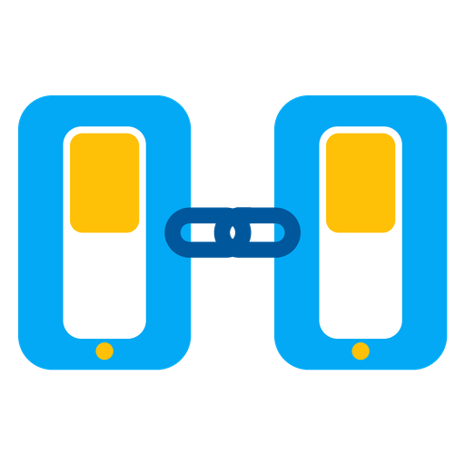

# Linked Entities

🇬🇧 [English](README.md) · 🇪🇸 **Español**

**Hacé que varias teclas, luces o botones funcionen como si fueran uno solo.**

Prendés cualquiera y se prenden todas. Apagás cualquiera y se apagan todas.
Y todas muestran siempre el mismo estado.

---

## ¿Para qué sirve?

### 💡 Una luz, dos teclas
Tenés una tecla inteligente que prende las luces del quincho y otra tecla inteligente
en el living que no está conectada a nada.
Las vinculás y ahora podés prender o apagar las luces del quincho desde cualquiera de las dos.
Si las prendés desde el quincho, la tecla del living también se marca como prendida.

### 🪜 Escalera o pasillo largo
Una tecla abajo y otra arriba, como las teclas de combinación de toda la vida,
pero sin pasar un solo cable nuevo.

### 🛏️ Botón en la mesa de luz
Tenés un botón inalámbrico al lado de la cama.
Cada vez que lo apretás, prende o apaga la luz del dormitorio (y la tecla de la pared queda igual).

### 🌀 Ventilador y luz juntos
Vinculás el ventilador de techo con su luz para que se prendan y apaguen juntos.

---

## Cómo se usa

1. Andá a **Ajustes → Dispositivos y servicios → Añadir integración** y buscá **Linked Entities**.
2. Ponele un nombre (por ejemplo, *Luces quincho*).
3. Elegí las teclas o luces que querés vincular.
4. Si tenés botones inalámbricos, agregalos en el campo de pulsadores (es opcional).
5. Elegí cuál es la tecla **principal**: la que está conectada de verdad a la luz.
6. Listo. Ya funcionan juntas.

Podés crear todos los vínculos que quieras, uno por cada grupo de teclas.
Para cambiar uno, entrá a la integración y tocá **Configurar**.

### Lo que vas a ver

Cada vínculo aparece como un dispositivo nuevo con:

- **Un interruptor con el nombre del vínculo** (ej. *Luces quincho*). Prende o apaga todo junto. Es ideal para el panel o para pedírselo al asistente de voz.
- **Sincronización activa**. Si lo apagás, las teclas dejan de copiarse entre sí hasta que lo vuelvas a prender.
- **Última fuente**. Te dice qué tecla se usó por última vez.

---

## Preguntas frecuentes

**¿Sirve con cualquier marca?**
Sí. Si Home Assistant ve la tecla como algo que se prende y se apaga, la podés vincular. Podés mezclar marcas y tipos (Wi-Fi, Zigbee, etc.).

**¿Qué pasa si una tecla se queda sin conexión?**
Las demás siguen funcionando normalmente. Cuando la tecla vuelve, se pone sola en el estado correcto.

**¿Qué pasa si se corta la luz o reinicio Home Assistant?**
Al volver, todas las teclas se acomodan según la tecla principal.

**¿Puedo poner la misma tecla en dos vínculos?**
No. Así se evita que las teclas se queden prendiendo y apagando entre sí.

**¿Funciona si Home Assistant está apagado?**
No: el vínculo lo maneja Home Assistant. La tecla conectada a la luz siempre sigue funcionando, pero las otras no la van a controlar mientras Home Assistant esté apagado.

**¿Necesito esto si solo tengo dos teclas?**
No es obligatorio. También lo podés hacer con una automatización, pero esta integración lo resuelve en un minuto, sin errores y para todos los casos que quieras.

---

## Instalación

### Con HACS (recomendado)
1. En HACS, abrí el menú **⋮ → Repositorios personalizados**.
2. Pegá `https://github.com/pabloantonelli/ha-linked-entities` y elegí **Integración**.
3. Buscá **Linked Entities**, instalala y reiniciá Home Assistant.

### Manual
Copiá la carpeta `custom_components/linked_entities` dentro de la carpeta `config/custom_components/` de tu Home Assistant y reinicialo.

---

¿Encontraste un problema o tenés una idea? [Abrí un issue](https://github.com/pabloantonelli/ha-linked-entities/issues).
