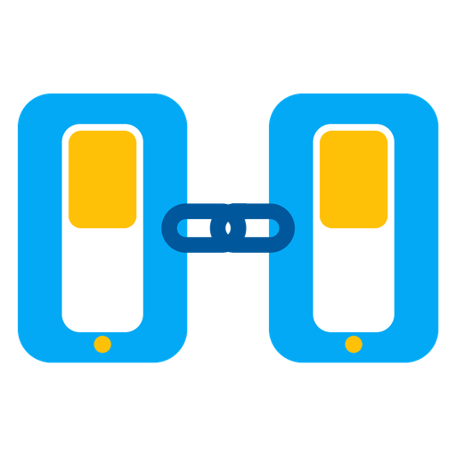

<p align="center"></p>

# Linked Entities

🇬🇧 **English** · 🇪🇸 [Español](README.es.md)

Home Assistant integration that **links on/off entities so they mirror each other**.
Turn any of them on or off (from the wall switch, the app, voice or an automation)
and all of them follow.

> Typical case: a smart wall switch wired to the patio lights, and a spare smart switch
> with no load somewhere else in the house. Link them and they behave like a single
> two-way (multi-location) switch.

## Features

- **Linked entities** (kept in sync both ways): `switch`, `light`, `fan`, `input_boolean`, from any protocol (Wi-Fi, Zigbee, Z-Wave, Matter… mixed freely).
- **Push buttons** (each press toggles the link): `event`, `button`, `input_button`. For `event` entities you can filter by event type (e.g. `press`, `single`).
- **Primary entity** (optional): the one wired to the physical load. Its state wins when Home Assistant starts and when it reconnects.
- **Loop prevention**: recognises its own commands (via `Context`), never commands entities already in the right state, and absorbs device bounces.
- **`unavailable` / `unknown`** are never propagated. An entity that comes back online is re-synced.

Each link creates a device with:

| Entity | Purpose |
|---|---|
| `switch.<name>` | A single switch that represents and controls the whole link (handy for dashboards and voice) |
| *Sync enabled* switch | Pause or resume synchronisation |
| *Last source* sensor | Diagnostics: which entity caused the last change |

The UI is available in **English and Spanish** (`es` and `es-419`).

## Installation (HACS)

1. HACS → ⋮ → *Custom repositories* → `https://github.com/pabloantonelli/ha-linked-entities`, category **Integration**.
2. Install **Linked Entities** and restart Home Assistant.
3. Go to *Settings → Devices & services → Add integration → Linked Entities*.

Manual install: copy `custom_components/linked_entities` into your `config/custom_components/` folder.

## Usage

Each link is one entry of the integration:

- **Add entry**: name, entities, push buttons, primary entity, debounce and event types.
- **Configure**: edit an existing link.
- **⋮ → Delete**: remove the link.

An entity can only belong to one link, to avoid loops between links.

## When *not* to use this

- **Just one pair, nothing else**: a single automation is enough (trigger: state change of A or B → apply to the other).
- **All Zigbee**: direct device *binding* (ZHA/Z2M) keeps working even if Home Assistant is down.
- **You only want one entity controlling several**, without them mirroring each other: use a group *helper*.

## Icon

The integration ships its own icon in `custom_components/linked_entities/brand/` (supported since Home Assistant 2026.3; older versions show a placeholder).

## Development

```bash
uv venv --python 3.13 .venv
uv pip install --python .venv/bin/python -r requirements_test.txt
.venv/bin/python -m pytest -q
```

## License

MIT
